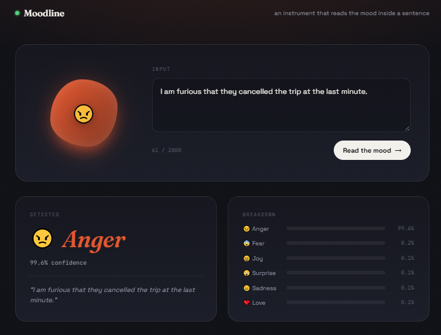

# Moodline — Emotion Classification

Moodline is an educational machine-learning web application that predicts the emotion expressed in a piece of text. It uses a trained Bidirectional GRU (BiGRU) model and presents the predicted emotion, its confidence score, and the scores for all supported emotions.

## Project Overview

The application accepts a sentence and classifies it into one of six categories: sadness, joy, love, anger, fear, or surprise. A FastAPI backend loads the trained model and tokenizer, preprocesses submitted text, and returns a prediction. The browser interface is served by the same FastAPI application.

## Project Objectives

- Demonstrate a text-classification workflow using a trained BiGRU model.
- Provide an API for predicting emotions from text.
- Present predictions and confidence scores in an interactive web interface.
- Show how a machine-learning model can be connected to a Python backend and browser frontend.

## Project Interface



## Features

- Browser-based interface for entering text.
- Emotion prediction across six categories.
- Confidence score and probability breakdown for every category.
- Health endpoint to check whether the model has loaded.
- Input validation for text between 1 and 2,000 characters.

## How the Application Works

1. **Model loading:** When the FastAPI server starts, it loads the saved model and tokenizer from `Artifacts/`.
2. **Text input:** The user enters a sentence in the Moodline interface.
3. **Preprocessing:** The backend lowercases the text, removes punctuation, and normalizes whitespace.
4. **Prediction:** The tokenizer converts the text to a padded sequence, which is passed to the BiGRU model.
5. **Result display:** The API returns the predicted emotion and class probabilities; the frontend displays them.

## Technologies

- **Machine learning:** TensorFlow/Keras, NumPy
- **Backend and API:** Python, FastAPI, Pydantic, Uvicorn
- **Frontend:** HTML, CSS, vanilla JavaScript
- **Model development:** Jupyter Notebook

## Run the Project Locally

### Requirements

- Windows with PowerShell.
- Python 3.11. The repository's `runtime.txt` specifies Python 3.11.9.
- The model and tokenizer files in the `Artifacts/` folder.

### 1. Open the project folder

Open PowerShell and change to the folder containing `main.py`:

```powershell
cd "C:\path\to\Emotion-Prediction"
```

Replace the example path with the location where you saved this repository. For example:

```powershell
cd "C:\Users\adnan\Downloads\Emotion Classificaion Project\Emotion-Prediction"
```

### 2. Create a virtual environment and install dependencies

Confirm Python 3.11 is available:

```powershell
py -3.11 --version
```

Then create the environment and install the required packages:

```powershell
py -3.11 -m venv .venv
.\.venv\Scripts\python.exe -m pip install --upgrade pip
.\.venv\Scripts\python.exe -m pip install -r requirements.txt
```

### 3. Start the application

Run the backend from the project folder:

```powershell
.\.venv\Scripts\python.exe -m uvicorn main:app --reload
```

The first startup may take a little while as the model and tokenizer are loaded. Keep this terminal open while you use the application.

### 4. Open the frontend

Visit **http://127.0.0.1:8000** in your browser. The frontend and backend are served by this same server; do not open `static/index.html` directly or start a separate static web server.

- **Application:** http://127.0.0.1:8000
- **Health check:** http://127.0.0.1:8000/health
- **Interactive API documentation:** http://127.0.0.1:8000/docs

Press `Ctrl+C` in the PowerShell window to stop the server.

## API Endpoints

- `GET /health` — reports server status and whether the model is loaded.
- `POST /predict` — accepts JSON such as `{"text": "I feel happy today"}` and returns the predicted emotion and probabilities.

## Project Structure

```text
Emotion-Prediction/
├── Artifacts/
│   ├── BiGRU_Model.keras
│   └── tokenizer.pkl
├── screenshots/
│   └── moodline-emotion-prediction.png
├── static/
│   ├── index.html
│   ├── script.js
│   └── style.css
├── final_clean.ipynb
├── main.py
├── requirements.txt
├── runtime.txt
├── .gitignore
└── README.md
```

- `main.py` — FastAPI application, model loading, preprocessing, and prediction endpoint.
- `Artifacts/` — trained model and tokenizer required by the application.
- `static/` — frontend page, styles, and browser-side JavaScript.
- `final_clean.ipynb` — notebook used for the project workflow.
- `requirements.txt` — Python dependencies.
- `runtime.txt` — Python runtime version.

## Responsible Use

This project is an educational demonstration. Emotion classification is an uncertain prediction from text, not a reliable assessment of a person's feelings or mental health. Do not use its results for diagnosis or consequential decisions about individuals.
